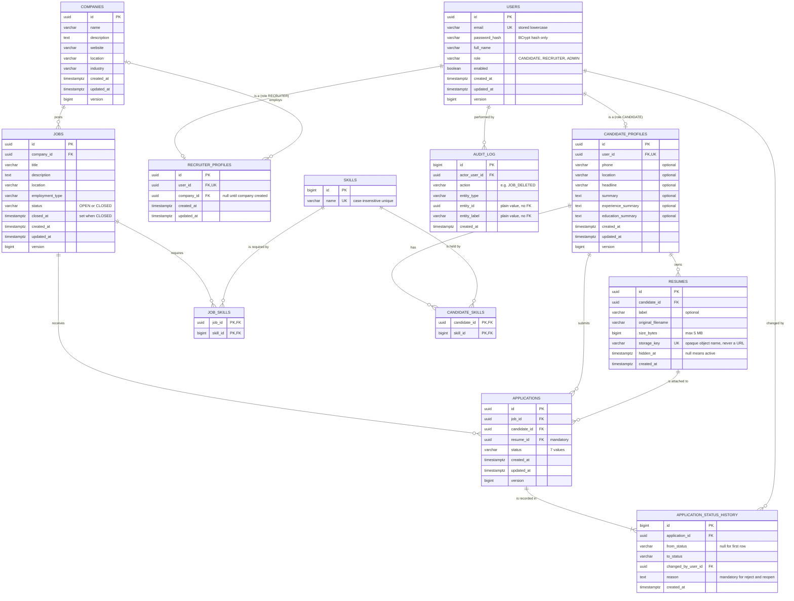

# HireSense – ER Diagram (initial design)

> **Version:** 0.3 (Task 0.6; **final sign-off given by the owner**; verification limitations below remain open)
> **Detail:** column types, constraints, indexes and the reasoning are in `docs/database/database-design.md`.
> **Status:** design only. **No tables exist yet**; migrations are written in Phase 1.
> **Source:** this file is the editable source (Mermaid text), which GitHub renders as a picture and which shows readable diffs in Git.
>
> **Verification status**
> - **Syntax: verified.** Mermaid's own parser (`mermaid` 11.4.1) accepted this diagram as an ER diagram, and a deliberately broken copy was rejected.
> - **Visual rendering: UNVERIFIED.** The diagram was not drawn in a browser or viewer in this session. Check how it looks on GitHub or in a Mermaid preview.
> - **Schema logic: preliminary check on PostgreSQL 16.4** (scratch, in memory, 48 of 48 checks; see section 14 of the database design). **Preliminary:** it must be repeated against the PostgreSQL version chosen in Phase 1.
> - **Flyway migrations and JPA mappings: not yet written or tested.**

---

## 1. Diagram

---

## 2. How to read it

| Symbol | Meaning |
|--------|---------|
| `\|\|` | exactly one |
| `o\|` or `\|o` | zero or one |
| `o{` | zero or many |
| `\|{` | one or many |
| `PK` / `FK` / `UK` | primary key / foreign key / unique key |

Examples:
- `USERS ||--o| CANDIDATE_PROFILES`: every candidate profile belongs to exactly one user; a user has zero or one candidate profile (only candidates have one).
- `JOBS ||--o{ APPLICATIONS`: a job has zero or many applications; an application belongs to exactly one job.
- `APPLICATIONS ||--|{ APPLICATION_STATUS_HISTORY`: every application has at least one history row (the creation row).
- `COMPANIES |o--o{ RECRUITER_PROFILES`: a company has zero or many recruiters; a recruiter has zero or one company (none until they create it).

## 3. The six roadmap entities and what was added

| Roadmap entity | Table |
|----------------|-------|
| `User` | `users` |
| `CandidateProfile` | `candidate_profiles` |
| `Company` | `companies` |
| `Job` | `jobs` |
| `Application` | `applications` |
| `Resume` | `resumes` |

**Added** (needed by approved requirements): `recruiter_profiles`, `application_status_history` (D-02, D-12), `audit_log` (D-12), and `skills` with the junction tables `job_skills` and `candidate_skills` (approved DD-04). 12 tables in total.

**MVP rule vs schema:** the diagram allows many recruiters per company (`COMPANIES |o--o{ RECRUITER_PROFILES`), but the **MVP business rule is one recruiter per company**, enforced in the service layer. The diagram shows what the schema can hold, not what the product allows today.

## 4. What the diagram cannot show

Rules enforced in the service layer or by constraints, listed in `docs/database/database-design.md`: the allowed status transitions, the limit of 5 active resumes per candidate, one role per user, and "a recruiter cannot post a job before a company exists".
